# Architecture

How `o3de.spec` turns the upstream Open 3D Engine source into a Fedora-installable RPM, and how that RPM behaves once installed. Intended audience: packaging contributors, reviewers evaluating the Fedora-inclusion request, and anyone debugging an unexpected build or runtime behavior.

For repo layout (which file goes where) see [`README.md`](README.md). For the per-bundle Fedora-readiness assessment see [`BUNDLED_LIBRARIES.md`](BUNDLED_LIBRARIES.md). For the staged plan to inclusion see [`FEDORA_ROADMAP.md`](FEDORA_ROADMAP.md).

```mermaid
flowchart TB
    subgraph SRC["Source acquisition"]
        S1["github.com/o3de/o3de releases<br/>tag tarball + LFS bundle"]
        S2["github.com/o3de/o3de.git<br/>any ref + git lfs pull"]
        SH["sources/make-snapshot-tarball.sh<br/>(git clone + git lfs pull + tar;<br/>LFS pull is load-bearing;<br/>GitHub archive endpoint strips it)"]
        S2 --> SH --> SNAP["o3de-&lt;commit&gt;.tar.gz<br/>+ sha256"]
    end

    subgraph DEPS["Build-time dependencies"]
        DPK1["Fedora repos<br/>(Stage 1 system swaps:<br/>zlib, freetype, libpng, expat, lz4,<br/>openexr, poly2tri, lua,<br/>assimp, sqlite, libsamplerate,<br/>googlebenchmark, vulkan-validation-layers,<br/>xxhash, rapidjson (not CS10);<br/>26.10 line adds libtiff from 2610.0-123<br/>(development + experimental from 123,<br/>stabilization from 125, stable at 26.10.0))"]
        DPK2["COPR<br/>hellaenergy/o3de-dependencies<br/>(o3de-qt5-rev9 (26.05 line only), PhysX, AWS SDK, azslc,<br/>ISPCTexComp, astc-encoder,<br/>mikkelsen (Stage 1 swap, not in Fedora),<br/>o3de-spirv-cross + o3de-dxc-spirv + o3de-mcpp-az<br/>(Stage 2 3-pack) + o3de-cityhash<br/>(Stage 1 swap, lib not in Fedora);<br/>o3de-<dep> naming, shared across majors (unversioned system paths)))"]
        DPK3["packages.o3de.org CDN<br/>(remaining bundled 3rdParty:<br/>Qt6 + PySide6/shiboken6<br/>(qt-6.10.2-rev8 on stabilization/26100,<br/>qt-6.11.2-rev1 on development)<br/>(26.10 line: system_qt6 swap REVERTED 2026-08-17;<br/>bundled PySide6 pins Qt_6_PRIVATE_API,<br/>Fedora Qt6 has only Qt_6.11_PRIVATE_API;<br/>exception in force, Option B pending) +<br/>PySide2 (26.05 line) +<br/>restricted (NvCloth, squish-ccr) +<br/>blocked-stage-3 (OIIO/OCIO) +<br/>blocked-stage-4 (OpenSSL) +<br/>bundled Python 3.10 +<br/>multiplatform (RapidXML AZ-fork, pybind11, glad))"]
    end

    subgraph SPEC["o3de.spec"]
        BC{"--with snapshot ?"}
        SHA["sha256sum -c verify"]
        AUTO["%autosetup -p1 (carry-patches Patch0001..0023)<br/>o3de_base_2610 (development_snapshot,<br/>or a release build with stable_tag >= 2610.0) gates off<br/>the merged-upstream 0001/0002/0004/0005/0007/0008/0009/0012/0016<br/>and the per-line swap gates 0006/0013 (Patch0014 + 0015 via swap_hook instead);<br/>stable + stabilization apply 0003/0010/0011/0014/0015/0018/0020/0023,<br/>development the same without 0018 (pessimizing-move),<br/>experimental adds 0022 (wayland_ui; 0021 only with wayland alone);<br/>0017+0019 (lrelease) system_qt6-only<br/>(inactive since the 2026-08-17 bundled-Qt6 revert);<br/>Find shims + Source77 over development in-tree providers"]
        TP["%bcond_with thirdparty_*<br/>extract bundles to LY_3RDPARTY_PATH"]
        BUILD["cmake Ninja Multi-Config<br/>profile + (debug if --with debug)<br/>+ second release/Monolithic pass<br/>(build-mono/, if --with monolithic)"]
        QTP["Qt jpeg/tiff plugin rebuild (--with qt6, bundled Qt)<br/>rebuild-qt-imageformats.sh (Source74) relinks<br/>libqjpeg/libqtiff against Fedora libjpeg.so.62 + libtiff.so.6;<br/>source pair picked by the bundled Qt version:<br/>6.10.2 = Source72/73, 6.11.2 = Source75/76"]
        INST["cmake --install<br/>+ shebang normalization<br/>+ Stage 2 binary-overlay symlinks<br/>(system_spirvcross, system_dxc)<br/>+ Stage 2 library-link (system_mcpp)<br/>+ swap set recorded in the installed SDK<br/>(+ development provider shims, 2610.0-125)"]
        DBG{"--with debug ?"}
        BC -->|no| S1
        BC -->|yes| SNAP
        S1 --> SHA
        SNAP --> SHA
        SHA --> AUTO --> TP --> BUILD --> QTP --> INST
        INST --> DBG
        DPK1 -.-> BUILD
        DPK2 -.-> BUILD
        DPK3 -.-> BUILD
    end

    subgraph INSTALL["Installed layout (RPMs produced)"]
        MAIN["o3deNNNN package (e.g. o3de2605, o3de2610)<br/>/opt/O3DE/&lt;DISPLAY_VERSION&gt;/ (CORE + DEFAULT + profile binaries)<br/>/usr/bin/o3deNNNN + per-major .desktop + metainfo + icons + SBOM<br/>Recommends: o3deNNNN-devel + project-build *-devel<br/>+ system_X-devel + wayland-devel (qt6 lines)<br/>Recommends: cmake (not Requires)<br/>Suggests: ros-lyrical-o3de-gem-deps (26.10+)"]
        DEVELPKG["o3deNNNN-devel subpackage<br/>(always produced; needed by every project build:<br/>launchers link AZ::AzGameFramework / AZ::Launcher.Static)<br/>/opt/O3DE/&lt;DISPLAY_VERSION&gt;/lib/Linux/profile/{,Default/}*.a<br/>/opt/O3DE/&lt;DISPLAY_VERSION&gt;/lib64/ (Recast/Detour; 26.05 line only)<br/>Requires: o3deNNNN = same NVR<br/>+ the swaps' -devel packages (2610.0-125)"]
        DBGPKG["o3deNNNN-debug subpackage<br/>(only when --with debug)<br/>/opt/O3DE/&lt;DISPLAY_VERSION&gt;/bin/Linux/debug/"]
        DBG -->|no| MAIN
        DBG -->|yes| MAIN
        MAIN --> DEVELPKG
        DBG -->|yes| DBGPKG
    end

    subgraph RT["Runtime (per-user)"]
        BIN["/usr/bin/o3deNNNN<br/>(menu entry / CLI)"]
        WRAP["o3deNNNN wrapper<br/>O3DE_ENGINE_PATH=/opt/O3DE/&lt;DISPLAY_VERSION&gt;<br/>O3DE_PYTHON_VERSION=3.10<br/>QT_QPA_PLATFORM=xcb for Project Manager when unset<br/>(not on --with wayland builds)"]
        MIG["first-run migration<br/>JSON-aware engine_path rewrite<br/>in &lt;project&gt;/user/project.json"]
        PY["~/.o3de/Python/venv/&lt;id&gt;/<br/>(get_python.sh, first run; one venv per engine path)"]
        UD["~/.o3de/user, ~/.o3de/Logs<br/>(writable state)"]
        CLI["/usr/bin/o3deNNNN-cli<br/>(scripts/o3de.sh; first use runs get_python.sh<br/>+ register --this-engine, 2610.0-126)"]
        ENG["/opt/O3DE/&lt;DISPLAY_VERSION&gt;/bin/Linux/<br/>$O3DE_BUILD_CONFIG/Default/o3de"]
        BIN --> WRAP --> ENG
        WRAP --> MIG
        WRAP --> PY
        WRAP --> UD
        CLI --> PY
        CLI --> UD
    end

    subgraph DIST["Distribution channels"]
        DC1A["COPR<br/>hellaenergy/o3de<br/>(stable: tracks tagged<br/>upstream releases, 26.05.0 today<br/>(17 swaps + xxhash/cityhash/rapidjson);<br/>26.10.0 (planned 2026-10-28): BCONDS_stable,<br/>qt6 + swap_hook + 21 swaps;<br/>see POST_RELEASE.md)"]
        DC1T["COPR<br/>hellaenergy/o3de-testing<br/>(pre-promotion soak for stable;<br/>Fedora updates-testing semantics;<br/>main HEAD -> ~48h soak -> stable)"]
        DC1B["COPR<br/>hellaenergy/o3de-stabilization<br/>(community testers,<br/>pre-release validation;<br/>active during stab/&lt;X&gt; windows, now stabilization/26100;<br/>snapshot + stabilization + development_snapshot<br/>+ qt6 + swap_hook + 21 swaps<br/>(from 2610.0-125))"]
        DC1S["COPR<br/>hellaenergy/o3de-development<br/>(engine o3de/o3de:development;<br/>development_snapshot + qt6 + swap_hook<br/>+ monolithic + 21 swaps (from 2610.0-123);<br/>Sunday 06:00 UTC cron via<br/>snapshot-development.yml)"]
        DC1C["COPR<br/>hellaenergy/o3de-experimental<br/>(native-Wayland preview on development:<br/>development stack + wayland + wayland_ui,<br/>no monolithic; F44/F45 builds)"]
        DC1D["COPR<br/>hellaenergy/o3de-testing-debug +<br/>hellaenergy/o3de-development-debug<br/>(debug bcond siblings: o3deNNNN-debug)"]
        DC2["o3debinaries.org<br/>(install instructions linking COPR<br/>+ docs/INSTALL.md)"]
        DC3["Fedora repo<br/>(see FEDORA_ROADMAP.md)"]
        DC4["Flathub<br/>(future, separate repo)"]
        INST -.-> DC1A
        INST -.-> DC1T
        INST -.-> DC1B
        INST -.-> DC1S
        INST -.-> DC1C
        INST -.-> DC1D
        INST -.-> DC2
        INST -.-> DC3
        INST -.-> DC4
        DC1T -.->|"promote after soak"| DC1A
    end

    subgraph ROS["ROS 2 (separate COPRs, not enabled by the O3DE ones)"]
        R1["COPR hellaenergy/ros2<br/>(Lyrical, for 26.10;<br/>ros-lyrical-o3de-gem-deps)"]
        R2["COPR hellaenergy/ros2-jazzy<br/>(Jazzy, for 26.05)"]
        MAIN -.->|"Suggests"| R1
    end

    subgraph TEST["Test gate (community-shared)"]
        T1["tests/integration-test.sh<br/>Tiers 1-5 (rpm / install / setup /<br/>engine smoke / project end-to-end)"]
        T2["tests/ui-smoke-test.sh<br/>Tier 6: Project Manager + Editor<br/>under Xvfb"]
        T4["tests/asset-bake-test.sh<br/>Tier 7: system-swap library-health<br/>(SONAME + symbol + linkage smoke<br/>across the Stage 1 + Stage 2 swaps, incl. cityhash)"]
        T5["tests/ap-spawn-smoke-test.sh<br/>Tier 8: AP+builder runtime smoke<br/>(catches process-lifecycle bugs)"]
        T6["tests/multiplayersample-build-test.sh<br/>Tier 9: full MultiplayerSample build<br/>+ AP batch + launcher-load smoke<br/>(all 4 targets: GameLauncher,<br/>ServerLauncher, HeadlessServer,<br/>bare gem; opt-in; ~60-90 min cold,<br/>~3-10 min warm)"]
        T7["tests/newspaper-delivery-build-test.sh<br/>Tier 10: NewspaperDeliveryGame<br/>build + bake + playable-game smoke<br/>(opt-in; ~30-60 min cold,<br/>~3-10 min warm)"]
        T8["tests/post-load-liveness-test.sh<br/>Tier 11: post-load liveness smoke<br/>(launcher survives N seconds<br/>after LEVEL_LOAD_END without<br/>crash/freeze; opt-in; ~60-90 s)"]
        T3[".github/workflows/test-installed.yml<br/>matrix: F44, F45, rawhide<br/>+ check-deps-drift.yml weekly cron"]
        DC1B -.-> T1
        DC1B -.-> T2
        DC1B -.-> T4
        DC1B -.-> T5
        DC1B -.-> T6
        DC1B -.-> T7
        DC1B -.-> T8
        DC1B -.-> T3
        DC1C -.-> T1
        DC1C -.-> T2
        DC1C -.-> T4
        DC1C -.-> T5
        DC1C -.-> T6
        DC1C -.-> T3
    end
```



## Eight separations to notice

> **Distro coverage.** Builds run on four chroots: **F44** (the primary production target), **F45** (the newly branched release), **fedora-rawhide** (the next Fedora, now F46), and **CentOS Stream 10** (upstream of RHEL 10). Each brings a different toolchain, which is what most of the chroot-specific handling exists for: rawhide ships Lua 5.5, so the `LUA_VERSION_NUM >= 505` patches fire only there, and CS10's older RPM 4.19 parser drives spec conventions like escaping `%%install` in comments. `o3de-experimental` currently builds F44 and F45 only. The running CS10 toolchain-compat list is in the `project_cs10_engine_build_blockers` memory note.

1. **Source-mode toggle** decides between a stable tarball and a reproducible snapshot tarball, but the rest of the spec is identical for both.
2. **3rdParty bundle toggles** are independent of source mode; each `--with thirdparty_<pkg>` extracts its `Source10x` tarball into `LY_3RDPARTY_PATH` before configure.
3. **System-library swaps** (Stage 1, the Fedora-inclusion track). Each `--with system_<lib>` swaps one bundled 3rdParty package for its Fedora equivalent, independent of every other toggle. See "How a Stage 1 system-library swap resolves" below for the mechanism, and [`BUNDLED_LIBRARIES.md`](BUNDLED_LIBRARIES.md) for current per-library status.
4. **Read-only engine, writable user state.** `/opt/O3DE/<version>/` is owned by root; all writable state lives in `~/.o3de/`. The launcher wrapper is the only bridge between them.
5. **One spec, many channels.** The same spec feeds five COPR channels (`o3de` stable, `o3de-testing` pre-promotion soak, `o3de-stabilization` community-tester, `o3de-development` dev-branch, `o3de-experimental` native-Wayland preview) plus two debug-config siblings (`o3de-testing-debug`, `o3de-development-debug`), o3debinaries.org (which today links to the COPR install instructions), and eventually Fedora itself; a future Flatpak reuses most of the tree with its own manifest. The channel is selected by bconds (`--with snapshot` / `stabilization` / `development_snapshot` / `qt6` / `swap_hook` / `monolithic` / `wayland` + `wayland_ui` / the system swaps) and the upstream engine ref a build targets (`development`, `stabilization/<X>`, a release tag), not by a packaging-repo branch (o3de-rpm is single-branch `main`). The Makefile keeps one swap list for every channel (`O3DE_SWAPS`) and a `BCONDS_<channel>` list mirroring each project's COPR chroots; `make -s print-copr-with CHANNEL=<c> [CHROOT=<chroot>]` prints the `--rpmbuild-with` list a chroot should carry. Only `o3de-development` is automated, via the Sunday `snapshot-development.yml` cron. A channel marker in the GUI version string (`-stabilization`, `-development.<commit>`, or empty for stable and testing) tells a tester which channel a build came from at a glance. `-experimental.<commit>` appears only with `--with experimental`, which the o3de-experimental chroots do not set, so today's experimental builds show `-development.<commit>`.
6. **Versioned multi-install.** The package name (`o3deNNNN`, e.g. `o3de2605`) and the install prefix (`/opt/O3DE/<DISPLAY_VERSION>/`) are both derived from the spec's `stable_tag`, the same path pattern as upstream's `.deb` and Windows installer (the `.deb` itself installs one release at a time: its package is named `o3de` for every release). Bumping `stable_tag` yields the next major's name and path with no other change, and two majors install side by side (`dnf install o3de2605 o3de2610`) with no overlap; per-engine venvs stay isolated because cmake hashes the engine root path. The `-debug` and `-devel` subpackages inherit the versioning. One deliberate exception: `engine.json`'s `engine_name` stays `"o3de"` (not versioned, as in upstream's source `engine.json`; upstream's `.deb` sets `o3de-sdk`) so third-party gems' `compatible_engines` lists still resolve. Both majors can be registered at once: a project configures against the newest registered engine its `project.json` accepts (the project's `cmake/EngineFinder.cmake`), so keeping a project on an older major takes a per-project pin (`edit-project-properties --user --engine-path`). Cross-major upgrades are never automatic; different majors are different engine lines.
7. **Three-source dependency model.** Every build-time 3rdParty dependency comes from exactly one of three places, and the migration work is about moving dependencies between them:

   * **Fedora system packages** (path 1), reached by the Stage 1 system swaps.
   * **The `hellaenergy/o3de-dependencies` COPR** (path 2), our license-clean rebuilds of things that aren't in Fedora proper (Stage 2; named `o3de-<dep>`, see separation 8). Two shapes: a binary the engine shells out to (e.g. spirv-cross, dxc), or a library the engine links (e.g. mcpp).
   * **The `packages.o3de.org` CDN** (path 3), everything still bundled, fetched at cmake-config time (so the COPR engine projects need `enable_net=true`).

   A Stage 1 swap moves a dependency from path 3 to path 1; a Stage 2 rebuild moves it from path 3 to path 2. The endgame leaves path 3 holding only the genuinely restricted bundles (NvCloth's NVIDIA license, squish-ccr's BC7 patent encumbrance). Current per-dependency placement and Fedora-readiness live in [`BUNDLED_LIBRARIES.md`](BUNDLED_LIBRARIES.md); drift between the three paths is watched by the weekly `check-deps-drift.yml` cron, which files a sticky issue on any mismatch.

8. **Shared dependency packages.** Our `o3de-dependencies` Stage 2 packages are named `o3de-<dep>` (e.g. `o3de-spirv-cross`), with no engine-major number, because they are shared across engine majors: the 26.05 and 26.10 lines pin the same 3rdParty versions, and each package owns an unversioned system path (`/usr/bin/dxc`, `/usr/bin/spirv-cross`, `/usr/bin/mcpp`, `/usr/lib64/libmcpp.so.0`), so a per-major copy could never co-install anyway. The engine packages (`o3de2605`, `o3de2610`) stay major-versioned because they genuinely coexist at separate `/opt/O3DE/<v>/` roots; the shared deps do not. A future ABI change in one of these is handled the normal Fedora way, by SONAME (`libmcpp.so.0`), not by a per-major package name. Each carries `Obsoletes`/`Provides` on the older engine-major-prefixed name so existing `Requires` keep resolving across the rename. Stage 1 system swaps use Fedora-conventional names throughout. The earlier `o3deNNNN-<dep>` convention and why it was walked back are in the `project_o3de_3p_versioning_research` memory note.

## How a Stage 1 system-library swap resolves

The mechanism has two halves: the engine's lazy 3rdParty resolution, and our gate-plus-shim that redirects it to a system library.

**Baseline (no swap).** `ly_associate_package(PACKAGE_NAME X-x.y-rev1 TARGETS X ...)` in `cmake/3rdParty/Platform/Linux/BuiltInPackages_linux_x86_64.cmake` does NOT download anything. It only registers a global `LY_PACKAGE_ASSOCIATION_X` property (`cmake/3rdPartyPackages.cmake`). Resolution is lazy: the first time a target declares a `3rdParty::X` build dependency and `X` is not yet a target, the engine (`cmake/3rdParty.cmake`) runs `ly_download_associated_package(X)` to fetch the prebuilt, then `find_package(X REQUIRED MODULE)`. So `find_package` is always reached; the prebuilt download just precedes it.

**With the swap (`--with system_X`, which passes `-DLY_USE_SYSTEM_X=ON`).** Patch0006 (plus the gem-local Patch0009 / Patch0013) wraps each associate line:

```cmake
if (NOT LY_USE_SYSTEM_X)
    ly_associate_package(PACKAGE_NAME X-x.y-rev1 TARGETS X ...)
else()
    find_package(X REQUIRED)
endif()
```

With the flag on, the prebuilt is never registered; `find_package(X)` runs eagerly at the BuiltInPackages site and creates the `3rdParty::X` target from the system library. Because the target then exists, the lazy path above is later skipped.

**Per-line vs central gating (which mechanism is live depends on the line).** Patch0006's per-line gating is the 26.05-line mechanism. On the 26.10 base (the spec's `o3de_base_2610`: every `--with development_snapshot` channel, and the stable and testing channels once `stable_tag` is 2610.0 or later) Patch0006 does not apply (its context drifted against upstream `development`), and a single central hook, **Patch0014**, does the same job generically for every swap: one guard inside `ly_download_associated_package()`. Patch0014 is activated by the `swap_hook` bcond, which is what carries the 21-library swap set (`O3DE_SWAPS`, since 2610.0-123) on the 26.10 line. Its companion **Patch0015** carries Patch0013's two Vulkan validation-layer runtime hunks without the associate gate; it applies on the 26.10 base since 2610.0-123 (through -122 it was gated off, so 26.10 builds shipped the bundled `libVkLayer_khronos_validation.so` next to `Requires: vulkan-validation-layers`). (Qt6 is a special case: the `system_qt6` swap that would have used this hook was reverted to bundled Qt6 on 2026-08-17 because the bundled PySide6 pins `Qt_6_PRIVATE_API`, which Fedora's Qt6 does not provide; see [`BUNDLED_LIBRARIES.md`](BUNDLED_LIBRARIES.md).)

**The shim satisfies `find_package(X)`.** We ship the find module as `sources/Find<X>-system.cmake` and copy it at `%prep` to `cmake/3rdParty/Find<X>.cmake` (the canonical name; the `-system` suffix is only our source-tree label). `cmake/3rdParty` is on `CMAKE_MODULE_PATH`, so `find_package(X)` resolves our module ahead of cmake's stock one. For libraries cmake already ships a module for (ZLIB, TIFF, Freetype, PNG, Lua), ours mostly delegates to the stock module and adds the `3rdParty::X` alias; a few (mikkelsen, expat, lua) bridge include paths or header-case on top.

**Two consumption patterns.** The above is the **prebuilt-package** path (`ly_associate_package`), which requires the gate patch because the associate line is what we have to intercept. The other pattern is **FetchContent** gems, which do `list(APPEND CMAKE_MODULE_PATH .../3rdParty)` then call `find_package(openmesh)` themselves, lazily, and only when the gem is enabled. Those can be swapped with NO patch: prepend a directory containing our `Find<X>.cmake` to `CMAKE_MODULE_PATH` and the gem's own `find_package` picks it up. As upstream migrates 3rdParty from prebuilt to FetchPackage (assimp already did, o3de/o3de#19365), those swaps become patch-free.

**A third pattern, development only: in-tree providers.** Since [o3de/o3de#20097](https://github.com/o3de/o3de/pull/20097) (2026-09-25), development builds rapidjson, xxhash, cityhash and mikktspace from `Code/3rdParty/<name>/CMakeLists.txt`, and a `3rdParty::<Name>` reference resolves from that directory before any Find module is consulted, so our `Find<X>.cmake` shim is never reached and the swap silently builds the bundled copy (this left `system_mikkelsen` inert on `o3de-development` until 2610.0-123). When the matching swap is on, `%prep` copies `sources/fetchcontent-provider-system.cmake` (Source77) over each provider's `CMakeLists.txt`, only where that file exists (`stabilization/26100` predates the move). It defines the provider's targets from the Fedora package through the existing Find shim, which installs with the engine's `cmake/` directory, so project builds against the installed SDK resolve the same way. `sources/sqlite-fetchcontent-system.cmake` (Source71) does the same for the FetchContent sqlite (o3de/o3de#20072).

**The installed SDK carries the swap set (from 2610.0-125).** The `LY_USE_SYSTEM_<X>` flags reach the engine's own configure, but upstream's install step does not record them, so a project configured against `/opt/O3DE/<version>` saw every flag off and downloaded the bundled packages. On o3de-stabilization 2610.0-120 a new project's profile GameLauncher exported the bundled Lua 5.4.4, `libAzCore.so` bound to it instead of the system Lua, and the launcher crashed at startup; on development a project configure stopped at `No "Findsqlite.cmake" found`. `%install` now appends `set(LY_USE_SYSTEM_<X> ON CACHE BOOL ...)` for the build's swap set to the installed `cmake/3rdParty/Platform/Linux/BuiltInPackages_linux_x86_64.cmake` (the generated file that includes the `Default/` or `Monolithic/` permutation, so both project build types see it), installs the development provider shims (sqlite, rapidjson, xxhash, cityhash, mikktspace) as the SDK's `Code/3rdParty/<name>/CMakeLists.txt`, and `o3deNNNN-devel` Requires the swaps' `-devel` packages. Checked on real stabilization 125 packages in fresh Fedora 45 and CentOS Stream 10 containers (2026-10-21): every Lua binding of a new project's launcher resolves to the system `liblua`, and no package is downloaded for a library swap. The two binary-only swaps, DXC and SPIRV-Cross, keep upstream's package fetch (the bundled package defines the CMake target; `%install` points the engine's `Builders/` paths at the system binaries), so a project configure still downloads both. The download goes unused: a project build copies neither binary, and the shader jobs of a development 126 release export ran the engine's linked `/usr/bin/dxc` (Fedora 44, 2026-10-22).

**Direction.** The central guard on the lazy resolver, `if (NOT LY_USE_SYSTEM_${pkg}) ly_download_associated_package(...) endif()` in `cmake/3rdParty.cmake`, makes the prebuilt path patch-free and lazy too: distros set `-DLY_USE_SYSTEM_<X>=ON` and drop a `Find<X>.cmake` on the module path, with no per-line BuiltInPackages patches and no over-eager resolution of gem-only libraries. This is exactly what Patch0014 (above) implements downstream, and it is proposed upstream as [o3de/o3de#19815](https://github.com/o3de/o3de/issues/19815) (sig-build). Landing it upstream would retire Patch0014 entirely.
